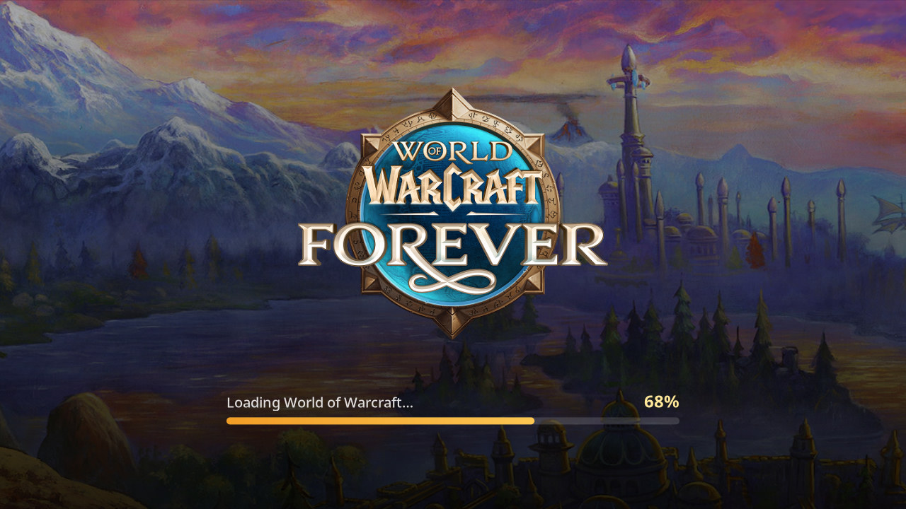

# WoW Splash



A [Decky Loader](https://github.com/SteamDeckHomebrew/decky-loader) plugin that shows a full-screen
**World of Warcraft Forever** loading screen while the game starts on the Steam Deck. It hides
the Proton console, the Battle.net windows and the flicker between them, and closes the moment
WoW's own window opens.

- WoW can be installed anywhere: the game folder is found from the running `Wow.exe`.
- A progress bar driven by what is really happening (Wine, Battle.net, Wow.exe, graphics device,
  game window), timed from your last 5 launches.
- Steps aside for Battle.net windows that need you (login, update, license, Install, Play) and
  comes back when the game starts, so a fresh install that isn't logged in yet works too.
- Stuck? Hold **View + Menu** on the Deck for 1.5 s, or use **Close splash** in the plugin menu.
- **Report a problem** opens a GitHub issue with your system info and the last launch filled in.
  You review it before submitting; nothing is sent automatically.
- Gaming Mode and Desktop Mode.

## Use

1. Add Battle.net to Steam as a non-Steam game and run it with Proton.
2. Open the Quick Access menu → Decky → **WoW Splash**.
3. Turn the splash on for your shortcut. Shortcuts with "Warcraft", "WoW" or "Battle.net" in the
   name are listed; turn on **Show all non-Steam shortcuts** if yours has another name.
4. If your shortcut starts the game by itself (e.g. a script that sends Battle.net
   `--exec="launch WoWF"`), turn on **Battle.net starts WoW by itself**. Otherwise the splash
   steps aside while Battle.net waits for you to press Play.

Turning it on adds a small wrapper to the shortcut's launch options, keeping your other options:

```
"/home/deck/.local/share/decky-wow-splash/launch.sh" <appid> %command%
```

Turning it off removes it. The wrapper lives outside the plugin folder, so if you uninstall the
plugin the game still starts (without the splash).

## When the splash steps aside

| Battle.net window | "starts WoW by itself" off | on |
|---|---|---|
| Login | after 6 s | after 6 s |
| Any other window of 300×200 or more (Play, update, Install...) | after 2 s | after 20 s |

It comes back as soon as `Wow.exe` starts. Launches where it stepped aside aren't used for the
progress timings.

## Requirements

SteamOS 3. Uses the system `python3`, GTK 3, PyGObject, pycairo and `xdotool`, all part of
SteamOS. No root access needed.

## Build

```
pnpm i
./package.sh        # -> out/decky-wow-splash-v<version>.zip
```

Install the zip from Decky's settings (Developer → Install plugin from ZIP).

Test the splash on the desktop with fake progress (`--preview-play` also fakes Battle.net
waiting for Play):

```
python3 defaults/splash/splash.py --preview
```

## How it works

- `main.py` writes the launch wrapper, stores per-shortcut options, closes the splash and
  gathers bug-report info.
- `src/index.tsx` lists your shortcuts and edits their launch options.
- `defaults/splash/splash.py` is the splash itself (GTK), with its art in `defaults/splash/art/`.
  In Gaming Mode gamescope would switch focus to every new launcher window; the splash keeps
  itself in front by pinning gamescope's base-layer window and app id on Steam's X display, and
  puts Steam's values back when done.

## Credits

Artwork from [SteamGridDB](https://www.steamgriddb.com/). World of Warcraft is a trademark of
Blizzard Entertainment; this plugin is not affiliated with Blizzard.

## License

BSD-3-Clause, based on the [Decky plugin template](https://github.com/SteamDeckHomebrew/decky-plugin-template).
